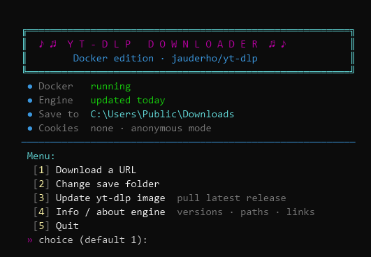
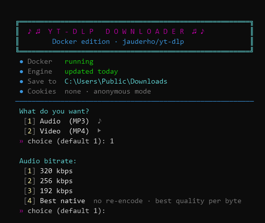
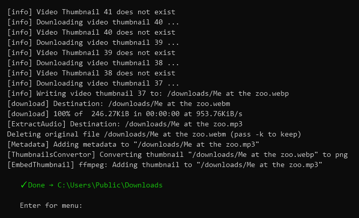
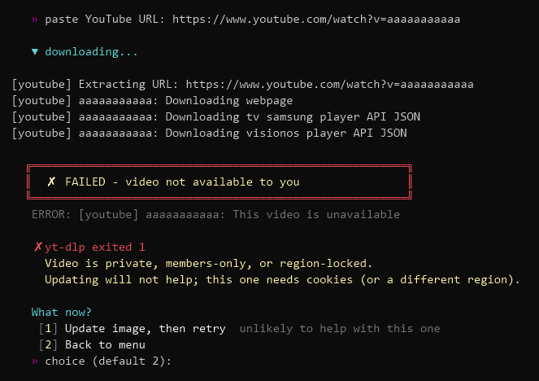

# YT-Downloader — Setup Guide

A menu-driven PowerShell script that downloads audio and video using
[yt-dlp](https://github.com/yt-dlp/yt-dlp) running inside Docker. No Python,
no ffmpeg, nothing installed on Windows itself — the entire engine lives in a
daily-rebuilt container image, so when a site breaks things, one `docker pull`
fixes it.

**It is not YouTube-only** (any *cough* *cough*). The URL you paste goes straight
to yt-dlp, which ships **1,755 extractors** in the current image — Vimeo,
SoundCloud, Bandcamp, Twitch, archive.org, and most of the rest. Anything
`yt-dlp --list-extractors` names will work:

```powershell
docker run --rm jauderho/yt-dlp:latest --list-extractors
```

YouTube is simply what the *failure diagnosis* is tuned for, since that's where
the interesting failures live (see [403 and 429](#403-and-429-are-opposite-problems)).
Everything else downloads exactly the same way.

```
Windows ── PowerShell script (menu UI)
              └── Docker Desktop (WSL2)
                     └── jauderho/yt-dlp image  ←  yt-dlp + ffmpeg, rebuilt daily
```

---

## Screenshots

| | |
|:--:|:--:|
|  |  |
| **Main menu** — engine freshness is on the banner | **Format picker** — audio/video, then quality |
|  |  |
| **Downloading** — transcode, metadata, thumbnail | **A failure** — named cause, and only the retries that can actually work |

Note the last one: the video is unavailable, so "Retry now" is not offered at all.
For a stale-image 403 it would be offered *and* preselected. See
[403 and 429 are opposite problems](#403-and-429-are-opposite-problems).

---

## Prerequisites

| Component | What for | Link |
|---|---|---|
| Windows 10/11 with WSL2 | VM backend for Docker | built-in |
| Docker Desktop | runs the yt-dlp container | [docker.com/products/docker-desktop](https://www.docker.com/products/docker-desktop/) |
| PowerShell 5.1+ | ships with Windows | built-in |
| `YT-Downloader.ps1` | the menu script | (this repo / your copy) |

---

## 1. Install Docker Desktop

```powershell
winget install Docker.DockerDesktop
```

Or download from [docker.com/products/docker-desktop](https://www.docker.com/products/docker-desktop/).

- Launch it once and let it finish setup (WSL2 backend is the default — keep it).
- Optional: Settings → General → **"Start Docker Desktop when you sign in"**.
  If you skip this, the script starts Docker for you when needed.

Verify:

```powershell
docker version    # must show BOTH "Client" and "Server" sections
```

## 2. Pull the yt-dlp image

```powershell
docker pull jauderho/yt-dlp:latest
```

- Image: [hub.docker.com/r/jauderho/yt-dlp](https://hub.docker.com/r/jauderho/yt-dlp)
- Dockerfile source: [github.com/jauderho/dockerfiles](https://github.com/jauderho/dockerfiles/tree/main/yt-dlp)
- Contains yt-dlp + ffmpeg on Alpine, rebuilt daily against the latest
  [yt-dlp release](https://github.com/yt-dlp/yt-dlp/releases).

(The script's menu option 3 does this same pull — this is your "fix it" button
whenever downloads start failing.)

## 3. Install the script

1. Save `YT-Downloader.ps1` somewhere permanent, e.g. `C:\Users\<you>\Desktop\Scripts\`.
2. Allow local scripts (one-time):

```powershell
Set-ExecutionPolicy -Scope CurrentUser RemoteSigned
```

3. Test it:

```powershell
& "C:\Users\<you>\Desktop\Scripts\YT-Downloader.ps1"
```

You should get the boxed menu. If Docker is stopped, the script starts it and
waits — first boot takes ~30 s.

## 4. Add the `yt` command (optional but recommended)

Make the script callable from any terminal:

```powershell
if (-not (Test-Path $PROFILE)) { New-Item -Path $PROFILE -Type File -Force | Out-Null }
notepad $PROFILE
```

Add this line (fix the path), save:

```powershell
function yt { & "C:\Users\<you>\Desktop\Scripts\YT-Downloader.ps1" }
```

Reload and run:

```powershell
. $PROFILE
yt
```

> Profiles are per-host: the PS 5.1 console, PowerShell 7, and VS Code's
> terminal each read a different `$PROFILE`. Add the function to each you use,
> or put it in `$PROFILE.CurrentUserAllHosts`.

## 5. Optional: cookies (age-gated / members-only / stubborn bot walls)

Not needed for normal public videos. When required:

1. Install a cookie exporter, e.g.
   [Get cookies.txt LOCALLY](https://chromewebstore.google.com/detail/get-cookiestxt-locally/cclelndahbckbenkjhflpdbgdldlbecc)
   (Chrome).
2. Log into YouTube — **use a throwaway Google account**, not your main one.
3. Export and save as `C:\Users\<you>\cookies.txt`.

The script auto-detects the file and switches to authenticated mode (shown in
the banner). Delete the file to go back to anonymous.

---

## Usage

```powershell
yt
```

Menu options: download a URL (audio 320/256/192 kbps MP3, best-native audio, or
video best/1080p/720p/480p), change save folder (Explorer picker), update the
yt-dlp image, engine info, quit. Downloads land in `~\downloads` by default.
Config lives at the top of the script (`$Image`, `$SaveDir`, `$CookiesFile`).

The banner shows an `Engine` line with how long ago you last pulled the image —
green up to a week, amber past that, red past two weeks.

### When a download fails

You get a boxed warning naming the actual cause, yt-dlp's own error text, and a
prompt whose options follow the diagnosis rather than offering a blind "try
again":

```
  ╔════════════════════════════════════════════════════════╗
  ║  ✗  FAILED - 403 Forbidden (stale image)               ║
  ╚════════════════════════════════════════════════════════╝
   ERROR: unable to download video data: HTTP Error 403: Forbidden

   ✗ yt-dlp exited 1
     403 Forbidden - this is NOT your IP. Do not switch VPN.
     ...

   What now?
    [1] Update image, then retry  recommended · fixes most 403s
    [2] Retry now  same image, will likely fail again
    [3] Back to menu
```

What's offered changes with the failure:

| Failure | Default action | Retry offered? |
|---|---|---|
| 403 / extractor / unrecognized | **Update image, then retry** | yes, but flagged as likely to fail |
| 429 / bot wall | **Back to menu** | yes, flagged **NOT recommended** — retrying makes a 429 worse |
| Disk or Docker problem | Back to menu | yes, neutral — fix the problem, then retry |
| Age-gated / private / region-locked | Back to menu | **no** — no number of retries can succeed |

---

## Troubleshooting

| Symptom | Cause | Fix |
|---|---|---|
| `error during connect: ... dockerDesktopLinuxEngine` | Docker engine not running | run `yt` (auto-starts it) or launch Docker Desktop |
| `400 Bad Request` / downloads suddenly fail everywhere | YouTube changed their API | menu option 3 (`docker pull`) |
| **`HTTP Error 403: Forbidden`** *(YouTube)* | **your local image is stale** — YouTube rotated its player JS and this yt-dlp can no longer sign media URLs | **menu option 3 (`docker pull`).** *Not* an IP problem — see below |
| `HTTP Error 403: Forbidden` *(any other site)* | either a stale image **or** a genuine IP block — many sites refuse datacenter ranges | update the image first; if that fails, retry **without** the VPN |
| `Sign in to confirm you're not a bot` / `HTTP 429` | your IP *is* rate-limited or flagged | hop VPN exit node / hotspot, or wait 30–60 min **without retrying**; cookies as last resort |
| `Sign in to confirm your age` | age-gated video | needs `cookies.txt` from a logged-in throwaway account; IP changes don't help |
| `yt` not recognized | function not in `$PROFILE`, or profile blocked | step 4; check `Get-ExecutionPolicy` isn't `Restricted` |
| Parse errors with `â` garbage in them | script file got re-encoded | current script is pure ASCII and immune; re-download it |
| `Is a directory: '/cookies.txt'` | mounting a cookies file that doesn't exist | the current script guards against this; delete any bogus `cookies.txt` *folder* in `%USERPROFILE%` |
| `vmmemWSL` eating RAM in Task Manager | that *is* Docker's WSL2 VM | normal; quit Docker Desktop + `wsl --shutdown` to reclaim, or cap it in `~\.wslconfig` |

**Rate-limit etiquette:** the script bakes in `--sleep-requests`/`--sleep-interval`
throttling. Don't remove it, and don't retry failures in a tight loop — that's
how an IP gets flagged in the first place.

### 403 and 429 are opposite problems

They look alike (both stop the download) and have contradictory fixes, so it's
worth keeping them straight:

| | `403 Forbidden` | `429` / bot wall |
|---|---|---|
| What it means | the media URL's signature is wrong | YouTube is throttling *you* |
| Cause | stale yt-dlp — YouTube rotated its player JS | IP reputation |
| Fix | `docker pull` (menu option 3) | wait, or change exit node |
| Does changing IP help? | **No** | Yes |

A 403 is a **signing** failure, not an access one: yt-dlp must run YouTube's
obfuscated JS to solve the `n` challenge and sign the `googlevideo.com` URL.
When your build can't solve the current challenge it produces a badly signed
URL, and googlevideo rejects it no matter who asks. Rotating VPN exit nodes
cannot fix this, and switching *mid-download* makes it worse — signed URLs are
bound to session context, so changing IP in flight invalidates the URL and
produces fresh 403s.

One detail that hides this: **small range requests still succeed on a bad
signature.** A short probe can return `200` while the full file returns `403`,
so a broken build can look like throttling or a bot wall when it has actually
been failing from byte one.

**Watch the `Engine` line in the banner.** It shows how long ago you pulled.
"Rebuilt daily" is the upstream *intent* — in practice the `latest` tag can
itself lag by a week, and `docker run` always serves your **local** cache, so
an image you pulled two months ago stays two months old until you pull again.

### …but only on YouTube

Everything above is about YouTube, where a 403 means a bad signature and your IP
is irrelevant. **Most other sites are the opposite.** Vimeo, for instance,
refuses datacenter ranges outright:

```
ERROR: [vimeo] ...: Got HTTP Error 403 ... If you are using a data center IP
or VPN/proxy, your IP may be blocked
```

That is a real IP block, and "don't switch your VPN" would be exactly the wrong
advice. The script checks the URL and the extractor name, so a non-YouTube 403
gets told that a VPN exit may genuinely be the cause and is worth dropping —
while a YouTube 403 still gets told the opposite.

---

## Notes

- **320 kbps reality check:** YouTube's source audio is ~128–160 kbps Opus.
  A 320 kbps MP3 is transcoded *up* from that — it can't sound better than the
  source. The "Best native" menu option keeps the original stream untouched
  and is the best quality-per-byte choice if you don't specifically need MP3.
- **Where things live:** yt-dlp is never installed on Windows. It exists only
  inside the Docker image, stored in Docker Desktop's WSL2 VM. The only thing
  touching your filesystem is the downloads folder (bind mount).
- **Security:** the container is `--rm` (destroyed after each run), the cookies
  file is mounted read-only, and URLs are passed as single argv entries (no
  shell injection surface). Cookies grant your full YouTube session to the
  tool — hence the throwaway-account advice.

## Links

- yt-dlp: <https://github.com/yt-dlp/yt-dlp>
- yt-dlp releases: <https://github.com/yt-dlp/yt-dlp/releases>
- yt-dlp FAQ (cookies): <https://github.com/yt-dlp/yt-dlp/wiki/FAQ>
- Docker image: <https://hub.docker.com/r/jauderho/yt-dlp>
- Image Dockerfiles: <https://github.com/jauderho/dockerfiles/tree/main/yt-dlp>
- Docker Desktop: <https://www.docker.com/products/docker-desktop/>
- GUI alternative (Parabolic): <https://github.com/NickvisionApps/Parabolic>

---

## Credits

This is a thin wrapper. The actual work belongs to:

- **[yt-dlp](https://github.com/yt-dlp/yt-dlp)** — the downloader and extractor
  doing all of the heavy lifting, including the JS challenge solving that this
  README's 403 section is entirely about. (Unlicense)
- **[jauderho/yt-dlp](https://github.com/jauderho/dockerfiles/tree/main/yt-dlp)**
  — the Alpine image that bundles yt-dlp + ffmpeg and rebuilds against upstream
  releases, which is what makes "just `docker pull`" a working fix.
- **[ffmpeg](https://ffmpeg.org/)** — audio extraction, transcoding, remuxing.

No code from any of those projects is vendored or modified here. This repo only
orchestrates the published container image from PowerShell.

## License

[MIT](LICENSE) — use it however you like, no warranty.

The license covers **this wrapper only**. yt-dlp, ffmpeg and the container image
carry their own licenses. What you download with it is your responsibility and is
subject to YouTube's Terms of Service and to your local law.
